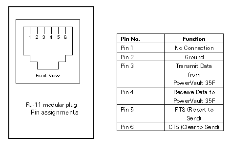
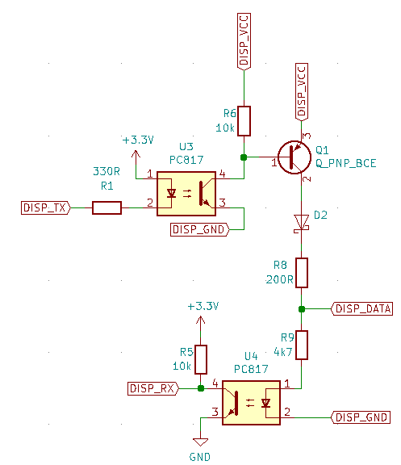

# Church indicator bus ("světelný ukazatel")

This is the main reference for the bus between the MIDIcontrol base and the existing church hymn indicator board.
It is an English translation of the owner's original V2 document
(`docs/indicator-bus/Komunikacni_protokol_svetelneho_ukazatele.odt`, 2020). The translation is followed by notes on
how the MIDIcontrol code uses the bus. The owner's expected behaviour on the bus is in `docs/SYSTEM.md`
(sec. 4.14 and sec. 5). The display SysEx (`F0 4D 43 ...`) that is embedded in song files and echoed to the PC is
**not** this bus format: see `midicontrol-fw/docs/display-sysex.md` and the mapping table below.

## 1. Physical interface (translated from V2)

Controllers connect to the indicator with an **RJ11** connector.

| RJ11 pin | Signal | Schematic net |
|---|---|---|
| 1, 3, 6 | not connected | - |
| 2 | data | `DISP_DATA` |
| 4 | ground | `DISP_GND` |
| 5 | supply | `DISP_VCC` |

- The supply from the indicator is **12-14 V**. It varies, probably with the line load.
- Data levels are about **14 V**.
- Controllers **both receive and transmit on the same data line**. Any controller may transmit, so the bus is multi-master.
- The line carries an **inverted UART at 1200 Bd**. The original document does not state the framing. The firmware uses 8N1.
- The control circuit is **fully isolated** from the indicator.

**Transmit path.** A PNP transistor (BC807 in practice) switches the indicator supply onto the data pin through a
protection diode and a resistor. That resistor must be about **200-300 Ω** (R8 = 200 Ω in the schematic). An opto-coupler
(PC817, U3) drives the transistor, so the transmit side is fully isolated.

**Receive path.** A second PC817 (U4) is used. Its LED is driven from the positive voltage on the data pin through a
**4k7** resistor.

**Inversion.** The circuit already inverts the signal in both directions. The MCU side is therefore a plain,
**non-inverted 3.3 V UART at 1200 Bd**. For a UART with a higher voltage, change R1 and the supply on the anode of the
U3 LED and on R5.

## 2. Frame format (translated from V2)

Every message to the indicator is **9 bytes**:

| Byte | 0 | 1 | 2 | 3 | 4 | 5 | 6 | 7 | 8 |
|---|---|---|---|---|---|---|---|---|---|
| Field | Flag | Verse ones | Verse tens | Song ones | Song tens | Song hundreds | Song thousands | Letter | LED |
| Value | `0xB0` | `0x0d` | `0x0d` | `0x0d` | `0x0d` | `0x0d` | `0x0d` | `0x0A`-`0x0D` | `0x2X` |

- **Flag.** Always `0xB0`. It marks a message for the display.
- **Verse.** 2 digits, one byte per digit, **ones first**.
- **Song.** 4 digits, one byte per digit, **ones first**, thousands last.
- **Letter.** The indicator can show a letter **A-D**. The byte's hex value is the letter: `0x0A` = A ... `0x0D` = D.
  Other values are also drawn and show unreadable segment patterns, except `0x0E` (see "Erase" below).
- **LED.** Format `0x2X`, with X = 0-3:

  | X | `0x20` | `0x21` | `0x22` | `0x23` |
  |---|---|---|---|---|
  | Colour | red | yellow | green | blue |

- **Erase.** If the **upper nibble of any field byte is `0xE`**, that part of the display is blanked and cleared, whatever
  the lower nibble is. `0xEX` in the LED byte switches all LEDs off. ("E" is probably for Erase.)

### Examples from V2

Song 1234, verse 56, letter A, yellow LED:

| Flag | V1 | V10 | S1 | S10 | S100 | S1000 | Letter | LED |
|---|---|---|---|---|---|---|---|---|
| `0xB0` | `0x06` | `0x05` | `0x04` | `0x03` | `0x02` | `0x01` | `0x0A` | `0x21` |

Song 12, verse 5, letter blank, LED off, **exactly as printed in V2**:

| Flag | V1 | V10 | S1 | S10 | S100 | S1000 | Letter | LED |
|---|---|---|---|---|---|---|---|---|
| `0xB0` | `0x05` | `0xEX` | `0xEX` | `0xEX` | `0x01` | `0x02` | `0xEX` | `0xEX` |

> **Typo (owner decision D24).** This second example contradicts the "ones first" rule: read by the rule, it shows
> "21  ", not "  12". The rule in the text is binding. Song 12 is `B0 05 E0 02 01 E0 E0 E0 E0`.

## 3. How MIDIcontrol uses the bus (from code, base `midicontrol-fw` `src/display.cpp`)

| Item | Implementation |
|---|---|
| UART | USART1 PA9 TX / PA10 RX, 1200 Bd, 8N1, no inversion in the MCU (the opto circuit inverts) |
| Presence | PC13 low = indicator connected (EXTI both edges). Nothing is sent while it is absent. On connect the current state is sent |
| Transmit | One 9-byte frame per change (about 75 ms on the wire). RX DMA is switched off while transmitting, so the base does not read its own echo. A frame in flight is never aborted |
| Receive | Every complete 9-byte frame (RX timeout 100 bit times; incomplete frames are dropped) replaces the base's state. It is echoed to the PC as display SysEx. Frames whose flag byte is not `0xB0` are dropped and counted (`indicator_bus.cpp` `frameAccepted`; D26, SYS-BUS-08; implemented, not verified on the bench) |
| Blank | The base writes `0xE0` for a blank field and `0xE0` for LED off |
| Song range | Songs go up to 1999 only (owner decision D23); spec limit. **Not enforced in the base**: the live path (`applyNowPlaying`) passes any thousands digit 0-9 and `setSong()` (which caps at 1999) has no caller; enforcement is a gap (SYSTEM.md gap, owner question) |
| Collisions | None today. The base waits for a quiet bus (`QUIET_MS` = 25 ms, `indicator::QuietBus`, gating the start of a frame in `display.cpp`) before transmitting (D25, SYS-BUS-05; implemented, not verified on the bench) |

### Mapping: NOW_PLAYING_INFO / display SysEx ↔ bus frame

| Field | NOW_PLAYING_INFO (PC → base) | Display SysEx (files, echo) | Bus byte |
|---|---|---|---|
| Digit | BCD nibble `0-9`, `0xF` blank | byte `0x00-0x09`, `0x0F` blank | `0x00-0x09`, `0xE0` blank |
| Letter | `0x0A-0x0D`, other = blank | `0x0A-0x0D`, `0x0F` blank | `0x0A-0x0D`, `0xE0` blank |
| LED red | `0x01` | `0x01` | `0x20` |
| LED yellow | `0x04` | `0x04` | `0x21` |
| LED green | `0x02` | `0x02` | `0x22` |
| LED blue | `0x03` | `0x03` | `0x23` |
| LED off | `0x00` / `0x0F` | `0x0F` | `0xE0` |
| Whole field | `0xFE` blank, `0xFF` no change, empty payload = clear all | target `0x00`-`0x04` | always the full frame |

The colour numbers differ between the SysEx and the bus (SysEx 2 = green, bus `0x21` = yellow). Always convert through
the table, never by arithmetic.
